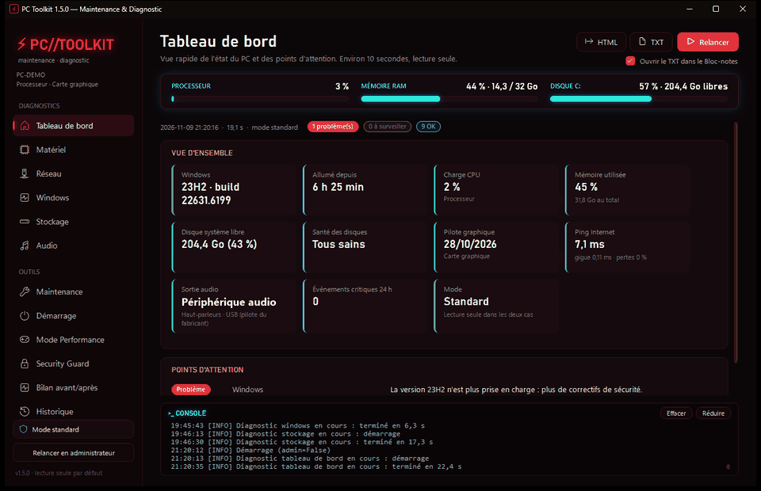

# ⚡ PC//TOOLKIT — maintenance et diagnostic

🇬🇧 [English version](https://github.com/TxF-AI/PC-Toolkit/blob/main/README.md)

[](https://github.com/TxF-AI/PC-Toolkit/actions/workflows/ci.yml)


Boîte à outils de diagnostic et d'optimisation pour Windows 10/11 : matériel, réseau, Windows, stockage, audio, maintenance et sécurité.
Interface sombre au rouge néon et cyan, **en français ou en anglais** (sélecteur FR / EN dans la barre latérale, appliqué à chaud ; par défaut la langue de Windows). **Aucun logiciel à installer** : Windows suffit. Rien n'est envoyé sur Internet.



## Points forts

- **Interface cyberpunk** : jauges CPU / RAM / disque C: en direct, lueurs néon, transitions et barres de progression animées, console de logs intégrée en bas de la fenêtre.
- **Security Guard** : audit léger de Windows Defender, du pare-feu et de l'UAC ; recherche d'éléments suspects (démarrage, tâches planifiées, dossiers Temp/AppData) ; scan d'un fichier ou dossier ; **quarantaine restaurable**. Ce n'est **pas** un antivirus : Windows Defender reste votre protection.
- **Presets 1-clic Jeu / MAO / Bureautique** : plan d'alimentation, services secondaires arrêtés temporairement, cache RAM, fichiers temporaires et démarrage, avec aperçu, confirmation et **restauration en un clic**. Le preset MAO garde la RAM intacte et ne touche jamais aux services audio.
- **Nettoyage maîtrisé** : fichiers temporaires, corbeille, cache DNS, et nettoyage automatique du démarrage avec liste blanche (pilotes graphiques et audio, sécurité, anti-cheat) ; rien n'est supprimé, tout se restaure.
- **Bilan avant/après sur 11 indicateurs** : espace libéré, RAM, services, processus, programmes au démarrage, fichiers temporaires, périphériques audio fantômes, éléments suspects actifs, menaces en quarantaine, profil d'optimisation… exportable en HTML et TXT.
- **Sûr par conception** : diagnostics en lecture seule, aperçu puis confirmation avant toute modification, aucune mesure inventée (« Non disponible »), aucune dépendance.

## 🎯 Pour qui ?

* **Utilisateurs avancés & Administrateurs Système :** Effectuez la maintenance approfondie de Windows, le diagnostic réseau et le nettoyage système via un moteur PowerShell natif sans dépendance externe.
* **Développeurs & Codeurs assistés par IA :** Conservez une machine rapide et débarrassée du superflu système qui ralentit vos compilations et vos environnements de dev locaux.
* **Adeptes du Minimalisme & de la Transparence :** Un kit d'outils propre sans dépendances tierces, développé en PowerShell et WPF natifs, disponible en version portable ou avec un installateur optionnel.

## Démarrage rapide

1. **Extraire le zip** : clic droit sur `PC-Toolkit-v<version>.zip` > **Extraire tout…**
   (ne pas lancer directement depuis l'intérieur du zip).
2. Choisir une des deux façons de l'utiliser :

| | Comment | Pour qui |
|---|---|---|
| **Portable** | Double-clic sur **`Lancer PC Toolkit.cmd`** | Essayer sans rien installer, ou l'utiliser depuis une clé USB |
| **Installation** | Double-clic sur **`Installer.cmd`** | L'utiliser souvent : raccourcis **⚡ PC∕∕TOOLKIT** sur le Bureau et dans le menu Démarrer |

L'installation copie l'application dans `%LocalAppData%\PCToolkit` et l'ajoute à **Paramètres > Applications installées**. Elle ne demande aucun droit administrateur et n'ajoute rien au démarrage de Windows.
Pour mettre à jour, relancez `Installer.cmd` depuis la nouvelle version : l'historique est conservé.
La version installée s'affiche en bas de la barre latérale et dans chaque rapport.

### Si Windows affiche un avertissement (SmartScreen)
PC Toolkit n'est pas signé numériquement (un certificat coûte plusieurs centaines d'euros par an) : Windows le traite donc comme un fichier inconnu venant d'Internet. C'est normal.
- **Avant d'extraire**, faites un clic droit sur le zip > **Propriétés** > cochez **Débloquer** > OK. Plus aucun avertissement ensuite.
- Ou, en PowerShell, après l'extraction (ou sur le zip avant de l'extraire) :
  ```powershell
  Get-ChildItem -Path "C:\chemin\vers\PC Toolkit" -Recurse | Unblock-File
  # ou, pour le zip seul :
  Unblock-File -Path .\PC-Toolkit-v1.6.0.zip
  ```
- Si l'écran bleu « Windows a protégé votre ordinateur » apparaît : cliquez **Informations complémentaires** > **Exécuter quand même**.
- Tout le code est lisible : ce sont des fichiers texte (`.ps1`, `.psm1`, `.xaml`) que vous pouvez ouvrir avec le Bloc-notes avant de lancer quoi que ce soit.

### Scripts non signés et politique d'exécution
PC Toolkit est un ensemble de scripts PowerShell **non signés**. Windows applique deux protections distinctes :

- **SmartScreen / « Mark of the Web »** : un fichier téléchargé reçoit une marque « venant d'Internet », d'où l'avertissement. Elle se retire avec `Unblock-File` :
  ```powershell
  Unblock-File -Path .\PC-Toolkit-v1.6.0.zip
  ```
  À faire **avant** d'extraire le zip (ou sur le dossier extrait avec `Get-ChildItem -Recurse | Unblock-File`).
- **Politique d'exécution PowerShell** : sur certains PC, les scripts sont bloqués (« l'exécution de scripts est désactivée sur ce système »). `Lancer PC Toolkit.cmd` contourne ce blocage pour sa propre session. Si vous lancez les scripts à la main depuis PowerShell, autorisez-les pour la **fenêtre en cours seulement** (rien n'est modifié durablement) :
  ```powershell
  Set-ExecutionPolicy RemoteSigned -Scope Process
  ```

Ces commandes ne touchent ni à Windows Defender ni aux réglages de sécurité du système.

### Vérifier que le zip n'a pas été modifié
Le fichier `PC-Toolkit-v<version>.zip.sha256.txt` fourni avec le zip contient son empreinte. Dans PowerShell, dans le dossier du zip :
```
Get-FileHash .\PC-Toolkit-v<version>.zip
```
Les deux suites de chiffres et de lettres doivent être identiques. Sinon, le fichier a été modifié ou abîmé pendant le transfert : ne l'utilisez pas.

## Ce que fait l'application

| Page | Contenu |
|---|---|
| Tableau de bord | **Jauges en direct** (CPU, RAM, disque C:) puis état général en 10 s : pilote graphique, ping, événements critiques, points d'attention. Console de logs intégrée en bas de la fenêtre (actions en temps réel) |
| Matériel | Processeur, mémoire (XMP, dual channel), carte graphique, BIOS, températures réellement exposées |
| Réseau | Connexion, DNS et DoH, latence, gigue, pertes de paquets, rapidité DNS |
| Windows | Version et fin de support, plantages, écrans bleus, journaux, services, démarrage, sécurité |
| Stockage | Espace libre, santé des disques, dossiers volumineux, gros fichiers |
| Audio | Votre sortie et votre micro **par défaut**, quels qu'ils soient : carte son intégrée (Realtek…), DAC ou interface USB, casque Bluetooth, HDMI, GoXLR, périphérique virtuel. Type de connexion, pilote, fréquences, ASIO, suspension USB, latence indicative |
| Maintenance | Fichiers temporaires, corbeille, cache DNS, SFC, DISM, CHKDSK, point de restauration |
| Historique et confidentialité | Fichiers récents et listes de raccourcis, téléchargements inachevés, remise à zéro des compteurs de données réseau (SRUM) |
| Démarrage | Programmes lancés avec Windows (clés Run, dossiers Démarrage) : activation / désactivation en un clic, optimisation automatique avec liste blanche (pilotes, audio, sécurité) et restauration en un clic ; rien n'est supprimé |
| Mode Performance | **Presets 1-clic Jeu / MAO / Bureautique** (plan d'alimentation, services secondaires, cache RAM, fichiers temporaires, démarrage) ou Mode Performance manuel ; restauration en un clic (administrateur requis pour le plan et les services) |
| Security Guard | Audit léger (**ce n'est pas un antivirus**) : état de Windows Defender et du pare-feu, éléments suspects au démarrage (clés Run, tâches planifiées, dossiers Temp/AppData), scan d'un fichier ou dossier (signature, double extension, empreintes connues, scripts malveillants connus). Mise en quarantaine ou désactivation après confirmation, restauration possible ; rien n'est supprimé |
| Bilan avant/après | Mesure de départ au début du diagnostic, tableau comparatif à la fin des nettoyages (espace libéré, RAM, services, processus, programmes au démarrage, fichiers temporaires, périphériques audio fantômes). En mémoire ; ajouté à la fin des exports HTML et TXT |
| Historique | Diagnostics enregistrés, export en rapport HTML ou TXT |

### Rapports
Chaque diagnostic s'exporte en **HTML**, mis en forme pour le navigateur, ou en **TXT**, du texte brut facile à coller sur Discord ou un forum.
La case **« Ouvrir le TXT dans le Bloc-notes »** ouvre directement le rapport. Décochée, elle sélectionne simplement le fichier dans l'Explorateur.

### Compteurs de données réseau
L'outil remet à zéro la base **SRUM** de Windows : la consommation de données par application, l'« Historique des applications » du Gestionnaire des tâches et, sur un portable, l'historique de la batterie.
- L'ancienne base n'est pas supprimée : elle est déplacée dans `C:\Windows\System32\sru.sauvegarde-<date>`.
- La commande `netsh int ip reset` n'est **pas** utilisée : elle réinitialise toute la configuration réseau (DNS, IP fixes) sans remettre les compteurs à zéro.

## Sécurité

- **Les diagnostics ne modifient rien** : ils se contentent de lire.
- Chaque action de maintenance explique ce qu'elle va faire et attend votre **Oui** avant d'agir.
- Les outils système (SFC, DISM, CHKDSK) s'ouvrent dans une fenêtre visible, après l'autorisation de Windows.
- Aucune mesure n'est inventée : ce que Windows n'expose pas s'affiche « Non disponible ».
- Rien n'est envoyé sur Internet, à part les pings et les requêtes DNS du test réseau.
- **Security Guard ne supprime jamais rien** : un fichier suspect est déplacé dans `Data\Quarantine` (restaurable), une tâche ou un démarrage est seulement désactivé. Ses constats sont des indices, pas des verdicts ; Windows Defender reste votre protection.
- Le bouton **Relancer en administrateur** est facultatif : il permet seulement de lire plus d'informations (santé SMART, températures des disques).

## Désinstaller

- **Version portable** : supprimez simplement le dossier.
- **Version installée** : **Paramètres > Applications > Applications installées > PC Toolkit > Désinstaller**.
  La désinstallation demande confirmation, propose de garder l'historique, puis retire les raccourcis, l'entrée Windows et le dossier `%LocalAppData%\PCToolkit`.

## Fichiers

```
PC Toolkit\
├─ Lancer PC Toolkit.cmd      lancement portable
├─ Installer.cmd / .ps1       installation (copie + raccourcis + entrée Windows)
├─ Desinstaller.ps1           désinstallation
├─ PCToolkit.ps1              application (interface)
├─ VERSION                    numéro de version (seule source)
├─ CHANGELOG.md / .fr.md        nouveautés de chaque version
├─ LICENSE                    licence MIT
├─ app.ico                    icône
├─ UI\MainWindow.xaml         design de l'interface
├─ Modules\*.psm1             un module par diagnostic + Core (base commune) + I18n (langues)
├─ Lang\fr.psd1, en.psd1      textes de l'interface, français et anglais
├─ Data\                      historique et journaux (créé à l'utilisation)
└─ Reports\                   rapports HTML et TXT exportés (créé à l'utilisation)
```

## Dépannage

- **Rien ne s'ouvre** : ouvrez PowerShell dans le dossier et lancez
  `powershell -ExecutionPolicy Bypass -NoProfile -File .\PCToolkit.ps1` pour voir le message d'erreur.
- Les erreurs techniques sont enregistrées dans `Data\Logs`.
- Configuration requise : Windows 10 ou 11, avec Windows PowerShell 5.1 (inclus dans Windows).

## Lancer les tests

La suite utilise Pester 3.4 (fourni avec Windows) ; depuis la racine du dépôt cloné :

```powershell
powershell -NoProfile -ExecutionPolicy Bypass -File .\Run-Tests.ps1
```

Le code de sortie est le nombre de tests en échec (`0` = tout est bon). Le zip de distribution ne contient pas les tests : ils sont dans le dépôt Git. Une intégration continue (GitHub Actions) les relance à chaque `push` et `pull_request` sur `main`.

## Méthodologie & AI Pair Programming

PC Toolkit est développé en **binôme humain / IA** :

- **Direction du projet (TxF-AI)** : cahier des charges de chaque version, choix d'architecture (interface WPF, un module PowerShell par page, jobs en arrière-plan), règles de sécurité non négociables (diagnostics en lecture seule, aperçu puis confirmation avant toute modification, sauvegarde et restauration, aucune mesure inventée, aucune dépendance), relecture et validation des résultats, tests sur de vrais PC, mise en place du CI/CD et de la publication.
- **Assistant de développement (Claude Code, Anthropic)** : utilisé comme *Senior Pair Programmer* pour prototyper vite et écrire la majeure partie du code, de la suite de **166 tests Pester** et de la documentation, sous cette direction et ces garde-fous.

Cette façon de travailler est un choix assumé : chaque changement passe par la suite de tests (`Run-Tests.ps1`), par la CI GitHub Actions et, pour les actions système, par un essai réel en administrateur avant livraison.

## Contribuer

Les contributions sont bienvenues : lisez [CONTRIBUTING.fr.md](CONTRIBUTING.fr.md) (règles du produit, pièges PowerShell 5.1, tests) puis ouvrez une issue avec les modèles *Signaler un bug* ou *Proposer une fonctionnalité*.

## Licence

[MIT](LICENSE) © 2026 TxF-AI. Fourni « tel quel », sans garantie : lisez l'aperçu de chaque action avant de confirmer.
